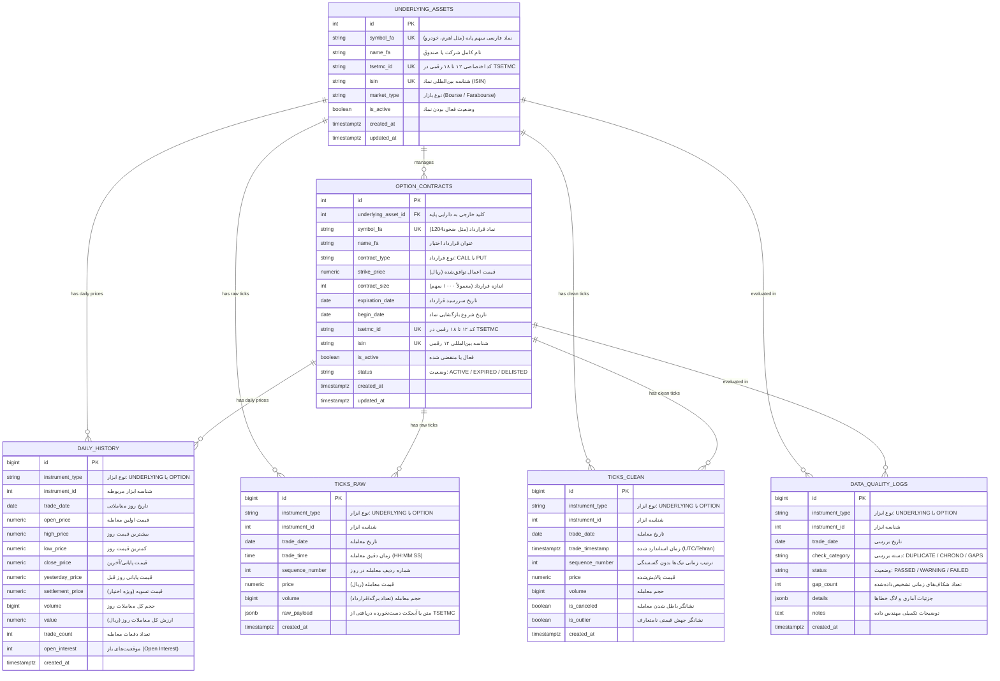

# نمودار رابطه موجودیت‌ها (ERD) و معماری پایگاه‌داده

این سند معماری پایگاه‌داده رابطه ای (PostgreSQL 16) را برای **پلتفرم داده‌ی تیک و بازار اختیار معامله بورس تهران (TSETMC)** مستند می‌کند. این طراحی در پاسخ به نیازمندی‌های **کارت E3-1** و اصول فاز ۱ درس الگوریتم‌های معاملاتی تنظیم شده است.

---

## ۱. دیاگرام ERD (Mermaid Diagram)

---

## ۲. مشخصات و قواعد یکپارچگی (Integrity Constraints)

### ۱. قیود بررسی دامنه (Check Constraints)
* `option_contracts.contract_type`: الزام به یکی از دو مقدار `'CALL'` یا `'PUT'`.
* `daily_history.instrument_type`: الزام به یکی از دو مقدار `'UNDERLYING'` یا `'OPTION'`.
* `ticks_raw.instrument_type` و `ticks_clean.instrument_type`: الزام به `'UNDERLYING'` یا `'OPTION'`.
* `data_quality_logs.status`: الزام به یکی از مقادیر `'PASSED'`, `'WARNING'`, یا `'FAILED'`.

### ۲. قیود یکتایی (Unique Constraints)
* `underlying_assets.symbol_fa` و `option_contracts.symbol_fa`: جلوگیری از تکرار نماد.
* `daily_history`: ترکیب یکتای `(instrument_type, instrument_id, trade_date)` مانع ثبت رکورد تکراری برای یک تاریخ در یک نماد می‌شود.
* `ticks_clean`: ترکیب یکتای `(instrument_type, instrument_id, trade_date, sequence_number)` سلامت ردیف معاملات درون‌روزی را تضمین می‌کند.

---

## ۳. استراتژی ایندکس‌گذاری (Indexing Strategy)

به دلیل حجم چند صد هزار الی چند میلیون تیک معاملاتی:
1. **شاخص‌های مرکب زمانی (Composite Time Indexes):**
   * روی `ticks_raw`: ایندکس `ix_raw_ticks_lookup` روی `(instrument_type, instrument_id, trade_date, trade_time)`.
   * روی `ticks_clean`: ایندکس `ix_clean_ticks_ts` روی `(instrument_type, instrument_id, trade_timestamp)`.
   * این شاخص‌ها کوئری‌های بازه‌ای درون‌روزی (Intraday window queries) و عملیات **As-of Join** بین سهم پایه و قراردادهای اختیار را در کسری از میلی‌ثانیه اجرا می‌کنند.
2. **شاخص‌های زنجیره اختیار (Option Chain Indexes):**
   * روی `option_contracts`: ایندکس مرکب `ix_option_ua_type_strike` روی `(underlying_asset_id, contract_type, strike_price)` برای ساخت آنی صفحه زنجیره اختیار (Option Chain Matrix).
   * ایندکس مرکب `ix_option_ua_expiry` روی `(underlying_asset_id, expiration_date)` برای فیلتر سررسیدهای نزدیک و دور.

---

## ۴. استراتژی پارتیشن‌بندی در مقیاس بالا (Partitioning Strategy)

در اسپرینت ۲ و با لود کامل تاریخچه ۲ ساله:
* جداول `ticks_raw` و `ticks_clean` می‌توانند بر اساس محدوده ستون `trade_date` به روش **Declarative Range Partitioning** سالانه یا ماهانه افراز (Partition) شوند (مثلاً `ticks_clean_1402`, `ticks_clean_1403`, `ticks_clean_1404`).
* این کار باعث افزایش چشمگیر سرعت Scan و نگهداری آسان‌تر دیسک (Vacuuming & Dropping Old Shards) می‌شود.

---

## ۵. چرخه انتقال داده (Lifecycle)

$$\text{TSETMC API} \xrightarrow{\text{Raw Dump}} \text{ticks\_raw} \xrightarrow[\text{Validation}]{\text{Deduplicate \& Order}} \text{ticks\_clean} \xrightarrow{\text{As-of Join \& Candles}} \text{REST API / Client}$$

* **لایه خام (Raw Layer):** پاسخ دست‌نخورده بورس ذخیره می‌شود تا در صورت کشف هرگونه باگ در پارسر، بدون خزش مجدد قابل بازتولید باشد.
* **لایه تمیز (Clean Layer):** داده‌های زمانی با منطقه زمانی یکپارچه شده، معاملات باطل‌شده فیلتر و ردیف‌ها کاملاً مرتب زمانی هستند.
* **لایه کیفیت (Quality Layer):** نتایج لاگ‌ها، گپ‌های زمانی بین تیک‌ها و مغایرت‌ها در `data_quality_logs` ماندگار می‌شوند.
