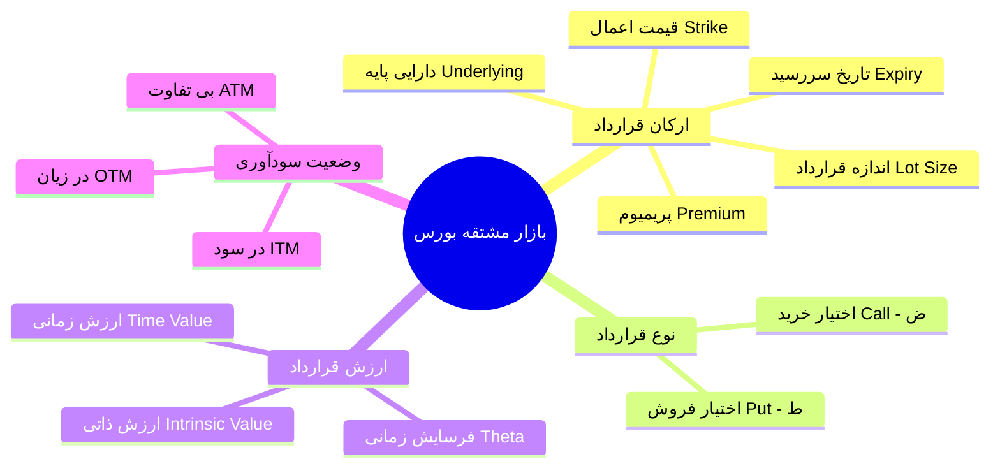
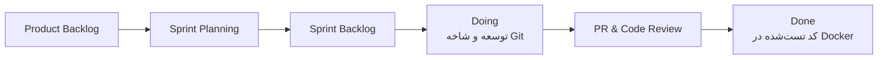

# دانشنامه و مرجع جامع درس الگوریتم‌های معاملاتی — فاز ۱
> **راهنمای کامل تمامی مفاهیم، اصطلاحات، معماری فنی، فرمول‌های مالی و فرآیندهای چابک**  
> *تهیه‌شده بر اساس سرفصل‌های فاز ۱ درس الگوریتم‌های معاملاتی — پاییز ۱۴۰۵*

---

## 📑 فهرست بخش‌های دانشنامه

1. [بخش ۱: فلسفه و چرایی این درس و فاز ۱](#بخش-۱-فلسفه-و-چرایی-این-درس-و-فاز-۱)
2. [بخش ۲: واژه‌نامه تخصصی بازار مالی و اختیار معامله (Finance & Derivatives)](#بخش-۲-واژه‌نامه-تخصصی-بازار-مالی-و-اختیار-معامله-finance--derivatives)
3. [بخش ۳: مفاهیم داده‌های مالی، سری‌های زمانی و محاسبات کمی (Quant & Time-Series)](#بخش-۳-مفاهیم-دادههای-مالی-سریهای-زمانی-و-محاسبات-کمی-quant--time-series)
4. [بخش ۴: معماری نرم‌افزار، مهندسی بک‌اند و پایگاه‌داده (Backend & Architecture)](#بخش-۴-معماری-نرم‌افزار-مهندسی-بک‌اند-و-پایگاهداده-backend--architecture)
5. [بخش ۵: زیرساخت بورس تهران و خزش داده (TSETMC & Polite Crawling)](#بخش-۵-زیرساخت-بورس-تهران-و-خزش-داده-tsetmc--polite-crawling)
6. [بخش ۶: فرآیند چابک، قوانین اسکرام و معیارهای ارزیابی (Scrum & Delivery)](#بخش-۶-فرآیند-چابک-قوانین-اسکرام-و-معیارهای-ارزیابی-scrum--delivery)

---

## بخش ۱: فلسفه و چرایی این درس و فاز ۱

### ۱. هدف نهایی درس «الگوریتم‌های معاملاتی» چیست؟
هدف درس، طراحی و اجرای **سیستم‌های معاملاتی خودکار (Algorithmic Trading / Automated Execution)**، استراتژی‌های آربیتراژ (Arbitrage)، بازارسازی (Market Making) و مدیریت ریسک سبد سرمایه‌گذاری بر روی بازار مشتقه بورس تهران است.

### ۲. چرا در فاز ۱ استراتژی معاملاتی نمی‌نویسیم؟
در مهندسی مالی یک اصل طلایی وجود دارد: **«ورودی آشغال = خروجی آشغال» (Garbage In, Garbage Out)**.  
اگر الگوریتم شما بر روی داده‌های ناقص، جابجا، دارای گپ زمانی، یا داده‌هایی که به آینده نگاه می‌کنند (Look-ahead bias) تست شود، روی کاغذ میلیون‌ها سود نشان می‌دهد اما در بازار واقعی تمام سرمایه را نابود می‌کند.  
بنابراین، **ماموریت فاز ۱** ایجاد **«بستر داده‌ای درجه‌یک (Production-Ready Data Platform)»** است که داده تیک به تیک بازار آپشن را از سال ۱۴۰۲ جمع کند، اعتبارسنجی کند، به هم بچسباند و به عنوان یک زیرساخت قابل‌اعتماد در اختیار الگوریتم‌ها قرار دهد.

---

## بخش ۲: واژه‌نامه تخصصی بازار مالی و اختیار معامله (Finance & Derivatives)



### ۱. دارایی پایه (Underlying Asset)
سهم یا صندوق سرمایه‌گذاری اصلی در بازار سهام که قرارداد مشتقه روی آن تعریف شده است.  
*در این پروژه:* **۲۵ دارایی پایه اصلی بازار آپشن** هدف هستند (مانند `اهرم`, `خودرو`, `خساپا`, `شستا`, `فملی`, `طلا`, `عیار`).

### ۲. قرارداد اختیار معامله (Option Contract)
قراردادی رسمی که به خریدار آن این **حق (اختیار)** را می‌دهد (بدون هیچ تعهدی) که دارایی پایه را در یک قیمت مقطوع و تا تاریخی مشخص بخرد یا بفروشد.

### ۳. اختیار خرید (Call Option)
* **تعریف:** حق خرید دارایی پایه در قیمتی مشخص.
* **دیدگاه خریدار:** صعودی (Bullish)؛ انتظار رشد قیمت دارد.
* **نمادگذاری در بورس تهران:** با حرف **«ض»** شروع می‌شود (مخفف ضمانت خرید)؛ مانند `ضخود1204` یا `ضهرم1033`.

### ۴. اختیار فروش (Put Option)
* **تعریف:** حق فروش دارایی پایه در قیمتی مشخص.
* **دیدگاه خریدار:** نزولی (Bearish) یا بیمه سبد سهام (Hedging).
* **نمادگذاری در بورس تهران:** با حرف **«ط»** شروع می‌شود؛ مانند `طخود1204` یا `طهرم1033`.

### ۵. قیمت اعمال (Strike Price / Exercise Price - $K$)
قیمت ثابت و توافق‌شده در متن قرارداد که در تاریخ سررسید مبنای معامله قرار می‌گیرد (مثلاً خرید خودرو به قیمت ۲,۸۰۰ ریال).

### ۶. تاریخ سررسید (Expiration Date - $T$)
آخرین روز کاری که قرارداد اعتبار دارد. پس از پایان ساعات معاملاتی این روز، قرارداد از تابلوی بورس حذف و منقضی (Expired) می‌شود.

### ۷. پریمیوم (Option Premium - $C$ یا $P$)
قیمتی که برای خرید این حق در تابلوی بورس معامله می‌شود و خریدار در لحظه خرید، نقداً به فروشنده می‌پردازد.

### ۸. اندازه قرارداد (Contract Size / Lot)
تعداد برگه سهم پایه که با داشتن ۱ قرارداد اختیار جابجا می‌شود. در بورس تهران معمولاً **۱,۰۰۰ سهم** است.

### ۹. خریدار (Holder / Long) در برابر فروشنده (Writer / Short)
* **خریدار (Long):** پریمیوم را می‌دهد، صاحب **حق** می‌شود. حداکثر ضررش همان پول پریمیوم است و سودش می‌تواند نامحدود باشد.
* **فروشنده (Short):** پریمیوم را می‌گیرد، ملزم به **تعهد** می‌شود. حداکثر سودش همان پریمیوم اولیه است اما ضررش در صورت جهش بازار نامحدود است.

### ۱۰. وجه تضمین (Margin Requirement)
مبلغی که اتاق پایاپای بورس از حساب **فروشنده اختیار** بلوکه می‌کند تا مطمئن شود اگر ضرر کرد، توانایی پرداخت بدهی خود به خریدار را دارد. خریدار هرگز نیازی به وجه تضمین ندارد.

### ۱۱. ارزش ذاتی (Intrinsic Value)
سود نقدی که اگر قرارداد **همین ثانیه** اعمال شود به دست می‌آید (هرگز منفی نمی‌شود):
* برای Call: $\text{IV} = \max(0, S - K)$
* برای Put: $\text{IV} = \max(0, K - S)$

### ۱۲. ارزش زمانی (Time Value)
مابه‌التفاوت پریمیوم بازار با ارزش ذاتی: $\text{Time Value} = \text{Premium} - \text{Intrinsic Value}$. این مبلغ بابت شانس تغییر قیمت سهم تا زمان سررسید پرداخت می‌شود.

### ۱۳. پدیده فرسایش زمانی / تتا (Time Decay / Theta $\Theta$)
با گذشت زمان و نزدیک شدن به سررسید، ارزش زمانی ذوب می‌شود تا در ثانیه پایانی سررسید دقیقاً به **صفر** برسد.

### ۱۴. وضعیت‌های سودآوری (Moneyness)
* **در سود (In-The-Money: ITM):** اعمال قرارداد در این لحظه سودآور است ($\text{IV} > 0$).
* **بی‌تفاوت (At-The-Money: ATM):** قیمت روز سهم تقریباً برابر با قیمت اعمال است ($S \approx K$).
* **در زیان (Out-Of-The-Money: OTM):** اعمال قرارداد در این لحظه توجیه ندارد و سود نقدی آن صفر است ($\text{IV} = 0$).

### ۱۵. نقطه سر‌به‌سر (Break-even Point)
قیمتی از دارایی پایه در سررسید که خریدار در آن نه سود می‌کند و نه زیان:
* در اختیار خرید: $\text{Break-even} = \text{Strike} + \text{Premium}$
* در اختیار فروش: $\text{Break-even} = \text{Strike} - \text{Premium}$

### ۱۶. موقعیت‌های باز (Open Interest - تعهدات باز)
تعداد کل قراردادهایی که تا انتهای روز معامله شده و هنوز تسویه یا اعمال نشده‌اند و در بازار فعال مانده‌اند (معیار اصلی عمق و نقدشوندگی بازار آپشن).

### ۱۷. قیمت تسویه (Settlement Price)
قیمتی است که اتاق پایاپای در پایان هر روز بر اساس میانگین وزنی معاملات و مدل بلک-شولز تعیین می‌کند تا مبنای محاسبه سود و زیان روزانه و تعدیل وجه تضمین کارگزاران قرار گیرد (با قیمت آخرین معامله متفاوت است).

### ۱۸. زنجیره اختیار (Option Chain Matrix)
جدولی استاندارد و دوطرفه که در ستون‌های سمت راست آن اطلاعات اختیار خرید (Call) و در سمت چپ اطلاعات اختیار فروش (Put) به ازای قیمت‌های اعمال مختلف چیده می‌شود.

---

## بخش ۳: مفاهیم داده‌های مالی، سری‌های زمانی و محاسبات کمی (Quant & Time-Series)

### ۱. داده روزانه (Daily History / OHLCV) در برابر داده تیک (Tick Data)
* **داده روزانه:** برای هر روز فقط یک رکورد وجود دارد شامل ۵ قیمت اصلی: Open (اولین معامله)، High (بیشترین)، Low (کمترین)، Close (پایانی) و Volume (حجم کل).
* **داده تیک (Tick Data):** ریزترین سطح ثبت داده در بازار مالی است؛ هر بار که یک معامله انجام می‌شود، ۱ رکورد شامل ساعت دقیق، قیمت و حجم تولید می‌شود.

### ۲. برش نازک سرتاسری (Thin Slice)
یک استراتژی توسعه چابک؛ به جای اینکه ماه‌ها منتظر بمانید تا کل داده‌ها دانلود شود، یک خط لوله کامل از **یک قرارداد در یک روز** می‌سازید:
$$\text{دریافت فایل خام} \longrightarrow \text{ذخیره دیتابیس} \longrightarrow \text{سرویس‌دهی API} \longrightarrow \text{نمایش در UI}$$
وقتی این خط لوله سالم کار کرد، سیستم را برای مقیاس کل بازار تعمیم می‌دهید.

### ۳. لایه ذخیره‌سازی خام (Raw Layer)
پاسخ دست‌نخورده سرور بورس به صورت فایل متنی یا JSON ذخیره می‌شود. فایده: اگر در آینده در تمیزکاری یا پارسر کدی باگ پیدا شود، نیاز به خزش مجدد صدها هزار ریکوئست نیست و دیتای خام دوباره پارس می‌شود.

### ۴. خطای نگاه به آینده (Look-Ahead Bias)
یکی از مهلک‌ترین خطاهای الگوریتم‌های معاملاتی. یعنی در زمان $t$ از داده‌ای استفاده کنیم که تا زمان $t+1$ در دنیای واقعی مشخص نبوده است (مثلاً برای تصمیم‌گیری در ساعت ۱۰:۰۰ صبح از قیمت پایانی ساعت ۱۲:۳۰ استفاده کنیم).

### ۵. پیوند همگام زمانی (As-of Join)
تیک‌های سهم پایه و تیک‌های اختیار معامله در یک صدم ثانیه هم‌زمان ثبت نمی‌شوند.  
**As-of Join** الگوریتمی است که برای هر تیک آپشن در زمان $t_1$، آخرین قیمت معلوم سهم پایه را در نزدیک‌ترین زمان ماقبل آن ($t_0 \le t_1$) به آن پیوند می‌دهد، بدون اینکه به آینده نگاه کند.

```
تیک سهم پایه:   (09:15:10, 3000) ----------------------> (09:15:30, 3010)
                                      \
                                       \ (As-of Join)
                                        v
تیک قرارداد آپشن:                  (09:15:22, 150)
```

### ۶. جلوبردن آخرین مقدار (Forward-Fill)
وقتی در یک بازه زمانی بین دو معامله هیچ تیکی ثبت نشده است، فرض می‌کنیم آخرین قیمت ثبت‌شده تا معامله بعدی معتبر باقی مانده است. در مقابل، روش‌هایی مثل میانگین‌گیری خطی (Linear Interpolation) خطای نگاه به آینده ایجاد می‌کنند و در بک‌تست ممنوع هستند.

### ۷. تجمیع کندل‌ها (Candle Resampling)
فرآیند ساخت کندل‌های ۱ دقیقه‌ای یا ۵ دقیقه‌ای از روی جریان پیوسته تیک‌ها با استخراج اولین تیک بازه (Open)، بالاترین (High)، پایین‌ترین (Low)، آخرین تیک (Close) و جمع حجم‌ها (Volume).

---

## بخش ۴: معماری نرم‌افزار، مهندسی بک‌اند و پایگاه‌داده (Backend & Architecture)

### ۱. معماری تمیز و طراحی دامنه-محور (Clean Architecture & DDD)
کدهای پروژه ما به ۴ لایه مجزا و ناوابسته تقسیم شده‌اند:
* **`domain/`:** موجودیت‌ها و بیزنس لاجیک خالص (کلاس‌های دیتا، بدون وابستگی به فریم‌ورک یا دیتابیس).
* **`application/`:** سرویس‌های واسط که موارد کاربرد را پیاده می‌کنند (`UnderlyingService`, `OptionService`).
* **`infrastructure/`:** لایه تکنولوژی شامل اتصال دیتابیس با PostgreSQL، ریپازیتوری‌ها، خزنده‌ها.
* **`interfaces/`:** درگاه‌های ارتباطی سیستم با دنیای بیرون شامل REST APIهای FastAPI.

### ۲. تزریق وابستگی (Dependency Injection - Container)
کلاس `Container` به عنوان مخزن مرکزی مدیریت چرخه حیات سرویس‌ها و نشست‌های دیتابیس (Sessions) عمل می‌کند و اتصالات ماژول‌ها را تمیز و مستقل از هم نگه می‌دارد.

### ۳. پایگاه‌داده PostgreSQL و کتابخانه غیرهمگام (Asyncpg + SQLAlchemy 2.0)
برای پشتیبانی از حجم بالای تیک‌ها و همزمانی کوئری‌ها، تمام ارتباطات با پایگاه داده بر بستر پروتکل غیرهمگام (Async I/O) با درایور فوق‌سریع `asyncpg` پیاده‌سازی شده است.

### ۴. ابزار مهاجرت پایگاه داده (Alembic Migrations)
ابزاری استاندارد برای مدیریت نسخه‌های اسکیما دیتابیس به صورت کد. هر تغییر در جداول دیتابیس با یک اسکریپت migration ذخیره می‌شود تا در محیط‌های دیگر یا داکر، دیتابیس دقیقاً با همان ساختار ساخته شود.

### ۵. فریم‌ورک FastAPI و استاندارد OpenAPI / Swagger
فریم‌ورک وب سریع و مدرن پایتون که به صورت خودکار مستندات تعاملی API را روی مسیرهای `/docs` و `/redoc` تولید می‌کند تا هم‌تیمی فرانت‌اند بتواند بدون نیاز به هماهنگی دستی اندپوینت‌ها را فراخوانی کند.

### ۶. کانتینرسازی با Docker و Docker Compose
* **Dockerfile:** محیط ایزوله‌شده پایتون شامل کل پیش‌نیازها و کدهای بک‌اند به همراه تست سلامت (Healthcheck).
* **docker-compose.yml:** ابزار هماهنگ‌کننده که با یک دستور `docker compose up`، پایگاه‌داده PostgreSQL و وب‌سرویس بک‌اند را هم‌زمان در یک شبکه داخلی بالا می‌آورد.

### ۷. آزمون‌سازی و ارزیابی کد (Pytest & Ruff)
* **Pytest:** فریم‌ورک تست خودکار برای اجرای تست‌های واحد و اطمینان از سلامت اندپوینت‌ها و محاسبات.
* **Ruff:** سریع‌ترین لینتر و فرمت‌کننده کد پایتون جهت تضمین استایل استاندارد و تمیزی کدها.

---

## بخش ۵: زیرساخت بورس تهران و خزش داده (TSETMC & Polite Crawling)

### ۱. دو درگاه اصلی وب‌سرویس بورس
1. **درگاه CDN بورس (`https://cdn.tsetmc.com/api/...`):**
   * کلید شناسایی: شناسه عددی ۶۴ بیتی (`insCode`).
   * اندپوینت‌های تیک، تاریخچه روزانه و جزئیات تابلوی نماد.
2. **درگاه رسمی شرکت بورس (`https://webgw.tse.ir/...`):**
   * کلید شناسایی: شناسه بین‌المللی نماد (`ISIN`).
   * اندپوینت‌های دیده‌بان آپشن (`MarketWatchOption`)، ساعت بازار و اطلاعیه‌های رسمی.

### ۲. خزشگر مؤدب (Polite Crawler)
ربات خزشگری که طوری طراحی شده تا به سرورهای بورس آسیب نزند و به عنوان حمله DDoS شناسایی نشود:
* **محدودکننده نرخ (Rate Limiter - Token Bucket):** ارسال حداکثر ۲.۵ تا ۳ درخواست بر ثانیه.
* **بازتلاش با تأخیر نمایی (Exponential Backoff with Jitter):** در صورت بروز خطای شبکه، سیستم بلافاصله درخواست جدید نمی‌زند؛ بلکه با فرمول $0.6 \times 2^{\text{attempt}} + \text{random}$ چند ثانیه صبر کرده و مجدداً تلاش می‌کند.
* **رعایت ساعات بازار:** عدم اجرای خزش سنگین داده‌های گذشته در ساعات معاملاتی بورس (۰۹:۰۰ الی ۱۲:۳۰).
* **هدرهای مرورگر:** ارسال هدرهای معتبر `User-Agent`, `Referer` و `Origin` برای جلوگیری از مسدودسازی توسط فایروال (WAF).

---

## بخش ۶: فرآیند چابک، قوانین اسکرام و معیارهای ارزیابی (Scrum & Delivery)



### ۱. اصطلاحات اسکرام در پروژه
* **اسپرینت (Sprint):** بازه‌های کاری ۲ هفته‌ای تکرارشونده.
* **بک‌لاگ محصول (Product Backlog):** لیست کل کارهای فاز ۱ که باید تا انتهای پروژه انجام شوند.
* **امتیاز کار (Story Point):** عدد سختی کار بر مبنای دنباله فیبوناچی ($1, 2, 3, 5, 8$)؛ نشان‌دهنده سختی نسبی کار، نه زمان ساعت‌کاری.
* **سرعت تیم (Velocity):** جمع امتیاز کارهای بسته‌شده در یک اسپرینت که مبنای تعهد حجم کار در اسپرینت بعدی است.
* **تعریف انجام‌شده (DoD: Definition of Done):** چک‌لیست نهایی یک کارت؛ کاری «انجام‌شده» است که کد آن روی شاخه مستقل با PR ادغام شده باشد، تست‌هایش پاس شوند، مستند شده باشد و در Docker اجرا گردد.

### ۲. مراسم‌های اسکرام (Scrum Ceremonies)
* **Planning (شنبه روز اول):** انتخاب کارهای اسپرینت و تقسیم تسک‌ها بین دو نفر.
* **Standup (۲ بار در هفته، ۱۵ دقیقه):** گزارش کوتاه: دیروز چه کردم؟ امروز چه می‌کنم؟ چه مانعی جلویم است؟
* **Review (جمعه پایان اسپرینت):** دموی زنده و ارائه کار به منتور.
* **Retrospective:** بازبینی درون‌تیمی برای بهبود روند کار.

### ۳. قوانین گیت و گیت‌هاب (ضوابط نمره‌دهی)
* Push مستقیم به شاخه `main` ممنوع است.
* هر تسک روی شاخه مستقل با نام کارت ساخته می‌شود (مثل `feat/E3-1-erd-schema-migrations`).
* پیام کامیت‌ها با استاندارد جهانی: `type(scope): message` (مانند `feat(database): ...`).
* ادغام فقط از طریق **Pull Request (PR)** و پس از تایید تست‌های پایپ‌لاین CI.

### ۴. تفکیک نمرات فاز ۱ (۵ نمره از ۱۲ نمره کل درس)

| بخش مورد ارزیابی | سهم نمره | وضعیت تیم شما تا این لحظه |
| :--- | :---: | :---: |
| **رجیستری، پوشش و کیفیت خزشگر** | **۱.۵ نمره** | با تسک‌های E5-1 و E1-1 کامل پیاده و مستند شد |
| **تمیزکاری، As-of Join و گزارش کیفیت داده** | **۱.۲۵ نمره** | ساختار اسکیما و مدل‌های ticks_clean و quality_logs در E3-1 آماده شد |
| **دیتابیس و بک‌اند** | **۱.۰ نمره** | دیتابیس PostgreSQL و مایگریشن‌های Alembic و FastAPI پیاده‌سازی شدند |
| **فرانت‌اند، داکر و README** | **۱.۲۵ نمره** | داکرایز کامل، Healthcheck، و README مهندسی تکمیل شد |
| **دفاع شفاهی، فرآیند گیت و آزمونک** | **۲.۰ نمره** | با مستندات کامل E9-1 و تاریخچه گیت آماده بالاترین نمره هستید |
