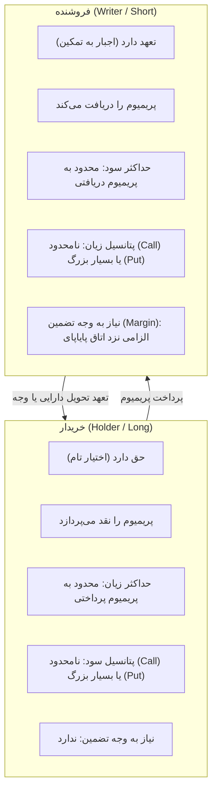

# راهنمای جامع بازار اختیار معامله بورس تهران (Options Primer)

این سند، مرجع یادگیری مفهومی، محاسباتی و کاربردی بازار مشتقه و اختیار معامله بورس اوراق بهادار تهران است که در راستای الزامات **کارت E9-1** جهت تسلط کامل بر مفاهیم مالی، قبولی در آزمونک درس الگوریتم‌های معاملاتی و دفاع شفاهی در برابر منتور تدوین شده است.

---

## ۱. ابزار مشتقه و مفهوم اختیار معامله (Options)

### ۱. ابزار مشتقه (Derivative) چیست؟
ابزار مشتقه قراردادی مالی است که ارزش آن از یک دارایی دیگر تحت عنوان **«دارایی پایه» (Underlying Asset)** مانند سهم، صندوق طلا یا شاخص مشتق می‌شود. دارنده‌ی این ابزار، خود سهم را در دست ندارد، بلکه قراردادی روی تغییرات قیمتی آن دارایی دارد.

### ۲. قرارداد اختیار معامله (Option Contract)
قراردادی است رسمی که به خریدار آن این **«حق» (نه اجبار و تعهد)** را می‌دهد که مقدار مشخصی از یک دارایی پایه را در قیمتی مشخص (قیمت اعمال) و تا تاریخی معین (تاریخ سررسید) بخرد یا بفروشد.

---

## ۲. ارکان شش‌گانه قراردادهای اختیار در بورس تهران

هر قرارداد اختیار معامله در بازار سرمایه ایران با ۶ مولفه اصلی تعریف می‌شود:

| رکن | نام انگلیسی و نماد | مفهوم به زبان ساده | مثال در بورس ایران |
| :--- | :---: | :--- | :--- |
| **۱. دارایی پایه** | **Underlying Asset ($S$)** | سهم یا صندوقی که قرارداد بر پایه آن صادر شده است. | صندوق اهرم (`اهرم`)، ایران خودرو (`خودرو`) |
| **۲. نوع قرارداد** | **Type** | حق خرید (**Call**) یا حق فروش (**Put**). | اختیار خرید اهرم / اختیار فروش اهرم |
| **۳. قیمت اعمال** | **Strike Price ($K$)** | قیمت مقطوع و توافق‌شده در قرارداد برای خرید/فروش سهم پایه. | ۶۰,۰۰۰ ریال برای اهرم |
| **۴. تاریخ سررسید** | **Expiration Date ($T$)** | آخرین مهلت زمانی که خریدار می‌تواند حق خود را اعمال کند. | ۱۴۰۵/۱۰/۳۰ |
| **۵. اندازه قرارداد** | **Contract Size / Lot** | تعداد برگه سهم پایه که در هر یک قرارداد جابجا می‌شود. | معمولاً **۱,۰۰۰ سهم** در بورس تهران |
| **۶. قیمت قرارداد** | **Premium ($C$ یا $P$)** | پولی که خریدار در لحظه معامله بابت خریدن «حق» به فروشنده می‌پردازد. | ۵,۰۰۰ ریال به ازای هر سهم (۵ میلیون ریال برای ۱ قرارداد) |

---

## ۳. عدم تقارن بنیادین حقوق و تعهدات (خریدار در برابر فروشنده)

تفاوت بنیادین معاملات اختیار با بازار عادی سهام در **عدم تقارن طرفین معامله** است:



> **نکته امتحانی مهم:** خریدار اختیار هرگز نیازی به تودیع وجه تضمین (Margin) ندارد چون در بدترین حالت حق خود را اعمال نمی‌کند و ریسک نکول ندارد. اما فروشنده اختیار تعهد سنگین دارد، بنابراین اتاق پایاپای بورس از حساب او **وجه تضمین اولیه و حداقل وجه تضمین** مسدود می‌کند تا از خطر نکول جلوگیری شود.

---

## ۴. انواع قراردادها: اختیار خرید (Call) و اختیار فروش (Put)

### الف) اختیار خرید (Call Option) — نمادهای با پیشوند «ض»
* **تعریف:** به خریدار این حق را می‌دهد که سهم پایه را در قیمت اعمال ($K$) بخرد.
* **دیدگاه خریدار:** دیدگاه **صعودی (Bullish)** دارد و انتظار دارد قیمت سهم در بازار بالاتر از $K$ برود.
* **نقطه سر‌به‌سر (Break-even):**
  $$\text{Break-even}_{\text{Call}} = K + C$$
  *(قیمت اعمال + پریمیوم پرداختی)*

### ب) اختیار فروش (Put Option) — نمادهای با پیشوند «ط»
* **تعریف:** به خریدار این حق را می‌دهد که سهم پایه را در قیمت اعمال ($K$) بفروشد.
* **دیدگاه خریدار:** دیدگاه **نزولی (Bearish)** دارد یا می‌خواهد دارایی خود را بیمه کند (Hedging).
* **نقطه سر‌به‌سر (Break-even):**
  $$\text{Break-even}_{\text{Put}} = K - P$$
  *(قیمت اعمال - پریمیوم پرداختی)*

---

## ۵. فرمول‌های ریاضی و نمودارهای سود و زیان در سررسید (Payoff)

به ازای هر سهم پایه در تاریخ سررسید ($S_T$):

| موقعیت معامله | فرمول سود و زیان در سررسید | نقطه سر‌به‌سر | حداکثر سود | حداکثر زیان |
| :--- | :---: | :---: | :---: | :---: |
| **خرید اختیار خرید (Long Call)** | $\max(S_T - K, 0) - C$ | $K + C$ | نامحدود ($\infty$) | پریمیوم پرداختی ($-C$) |
| **فروش اختیار خرید (Short Call)** | $C - \max(S_T - K, 0)$ | $K + C$ | پریمیوم دریافتی ($+C$) | نامحدود ($-\infty$) |
| **خرید اختیار فروش (Long Put)** | $\max(K - S_T, 0) - P$ | $K - P$ | $K - P$ (اگر سهم به صفر برسد) | پریمیوم پرداختی ($-P$) |
| **فروش اختیار فروش (Short Put)** | $P - \max(K - S_T, 0)$ | $K - P$ | پریمیوم دریافتی ($+P$) | $P - K$ |

---

## ۶. تفکیک پریمیوم: ارزش ذاتی (Intrinsic Value) و ارزش زمانی (Time Value)

هر قیمتی که برای یک آپشن در تابلوی بورس مشاهده می‌کنید، مجموع دو جزء است:

$$\text{Option Premium} = \text{Intrinsic Value} + \text{Time Value}$$

### ۱. ارزش ذاتی (Intrinsic Value):
* سودی که اگر قرارداد **همین الان** اعمال شود، عاید دارنده آن می‌شود. اگر اعمال آن در لحظه سودی نداشته باشد، ارزش ذاتی **صفر** است (ارزش ذاتی هرگز منفی نمی‌شود):
  * برای Call: $\text{IV} = \max(0, S - K)$
  * برای Put: $\text{IV} = \max(0, K - S)$

### ۲. ارزش زمانی (Time Value):
* پولی است که معامله‌گران بابت احتمال و «امید» به حرکت قیمت سهم تا زمان سررسید می‌پردازند.
  $$\text{Time Value} = \text{Premium} - \text{Intrinsic Value}$$
* **پدیده ذوب زمان یا فرسایش زمانی (Time Decay / Theta $\Theta$):**  
  هر چه به تاریخ سررسید نزدیک‌تر می‌شویم، ارزش زمانی قرارداد کاهش می‌یابد و در ثانیه پایانی سررسید، ارزش زمانی دقیقاً به **صفر** می‌رسد ($\text{Premium} = \text{Intrinsic Value}$).

---

## ۷. وضعیت‌های سودآوری قرارداد (Moneyness)

قراردادها بر اساس نسبت قیمت لحظه‌ای سهم پایه ($S$) به قیمت اعمال ($K$) در سه وضعیت طبقه‌بندی می‌شوند:

```
               [ وضعیتهای اختیار خرید (Call) ]
     S < K                      S ≈ K                     S > K
 ┌───────────┐              ┌───────────┐             ┌───────────┐
 │   OTM     │              │    ATM    │             │    ITM    │
 │ (در زیان) │              │ (بی‌تفاوت) │             │  (در سود) │
 └───────────┘              └───────────┘             └───────────┘

               [ وضعیتهای اختیار فروش (Put) ]
     S < K                      S ≈ K                     S > K
 ┌───────────┐              ┌───────────┐             ┌───────────┐
 │   ITM     │              │    ATM    │             │    OTM    │
 │  (در سود) │              │ (بی‌تفاوت) │             │ (در زیان) │
 └───────────┘              └───────────┘             └───────────┘
```

| وضعیت سودآوری | مخفف | شرط در اختیار خرید (Call) | شرط در اختیار فروش (Put) | ارزش ذاتی |
| :--- | :---: | :---: | :---: | :---: |
| **در سود (In-The-Money)** | **ITM** | $S > K$ | $S < K$ | مثبت ($> 0$) |
| **بی‌تفاوت (At-The-Money)** | **ATM** | $S \approx K$ | $S \approx K$ | صفر ($= 0$) |
| **در زیان (Out-Of-The-Money)** | **OTM** | $S < K$ | $S > K$ | صفر ($= 0$) |

> **هشدار:** قرارداد OTM بی‌ارزش نیست! ارزش ذاتی آن صفر است اما به دلیل زمان باقی‌مانده تا سررسید، **ارزش زمانی** دارد.

---

## ۸. خاصیت اهرمی اختیار معامله (Financial Leverage)

چرا معامله‌گران جذب بازار اختیار معامله می‌شوند؟ به دلیل **اهرم عملیاتی (Leverage)**.

### مثال مقایسه‌ای عددی:
* سهم پایه «اهرم» در قیمت $S = 70,000$ ریال معامله می‌شود.
* قرارداد اختیار خرید «ضهرم» با قیمت اعمال $K = 70,000$ ریال و پریمیوم $C = 7,000$ ریال در بازار موجود است.
* اگر شما ۷۰ میلیون ریال سرمایه داشته باشید:
  * **استراتژی ۱ (خرید سهم):** می‌توانید ۱,۰۰۰ برگه سهم اهرم بخرید. اگر قیمت سهم ۱۰٪ رشد کند و به ۷۷,۰۰۰ ریال برسد، سود شما = **۷ میلیون ریال (۱۰٪ سود)**.
  * **استراتژی ۲ (خرید اختیار خرید):** با ۷۰ میلیون ریال می‌توانید ۱۰ قرارداد (۱۰,۰۰۰ برگه اختیار) بخرید. در سررسید اگر سهم به ۷۷,۰۰۰ ریال برسد، ارزش هر برگ آپشن حداقل ۷,۰۰۰ ریال ارزش ذاتی دارد و کل سود شما = **۷۰ میلیون ریال (۱۰۰٪ سود)**!
* در این مثال بازدهی آپشن **۱۰ برابر** بازدهی سهم پایه بوده است (اهرم ۱۰ برابری).

---

## ۹. فرآیند تسویه در بورس تهران (Settlement)

در روز سررسید، دو مدل تسویه امکان‌پذیر است:
1. **تسویه فیزیکی (Physical Settlement):** خریدار وجه نقد را پرداخت کرده و ۱۰۰۰ برگه سهم پایه را از فروشنده تحویل می‌گیرد (یا در Put سهم را تحویل داده و پول می‌گیرد).
2. **تسویه نقدی (Cash Settlement):** بدون جابجایی برگه سهام، تنها مابه‌التفاوت قیمت اعمال و قیمت تسویه پایانی دارایی پایه توسط اتاق پایاپای به حساب خریدار واریز و از حساب فروشنده کسر می‌شود.

---

## ۱۰. بانک سوالات آزمونک شبیه‌سازی‌شده (Quiz Bank)

برای آمادگی کامل در آزمونک و مصاحبه منتور، به این ۱۰ سوال و پاسخ‌های تشریحی آن‌ها دقت کنید:

#### سوال ۱: تفاوت اصلی ریسک خریدار و فروشنده یک اختیار خرید چیست؟
* **پاسخ تشریحی:** خریدار اختیار خرید حداکثر به اندازه پریمیومی که پرداخت کرده ریسک ضرر دارد و سود او نامحدود است. اما فروشنده اختیار خرید حداکثر سودی که می‌تواند کسب کند برابر با همان پریمیوم اولیه است و پتانسیل زیان او در صورت جهش شدید سهم، نامحدود خواهد بود.

#### سوال ۲: نماد «ضخود1204» چه ویژگی‌هایی دارد؟
* **پاسخ تشریحی:** 
  1. شروع با «ض» $\rightarrow$ اختیار خرید (Call Option).
  2. دارایی پایه $\rightarrow$ سهام ایران خودرو (`خودرو`).
  3. رقم انتهای نماد $\rightarrow$ تاریخ سررسید ۴ اسفند (`1204`).

#### سوال ۳: سهمی در بازار ۳,۰۰۰ ریال است. قرارداد اختیار خرید با استرایک ۲,۸۰۰ ریال و پریمیوم ۳۵۰ ریال معامله می‌شود. ارزش ذاتی و زمانی چقدر است؟
* **پاسخ تشریحی:**
  * ارزش ذاتی: $\max(0, 3000 - 2800) = 200$ ریال.
  * ارزش زمانی: $\text{Premium} - \text{IV} = 350 - 200 = 150$ ریال.
  * وضعیت قرارداد: چون $S > K$ است، قرارداد **ITM (در سود)** است.
  * نقطه سر‌به‌سر: $K + C = 2800 + 350 = 3150$ ریال.

#### سوال ۴: چرا ارزش یک قرارداد اختیار با گذشت زمان کاهش می‌یابد حتی اگر قیمت سهم تکان نخورد؟
* **پاسخ تشریحی:** به دلیل پدیده **فرسایش زمانی (Time Decay یا تتا $\Theta$)**. با نزدیک شدن به سررسید، احتمال اینکه سهم جهش‌های بزرگ به نفع خریدار داشته باشد کمتر می‌شود؛ بنابراین ارزش زمانی قرارداد تبخیر شده تا در سررسید به صفر برسد.

#### سوال ۵: چرا فروشنده آپشن باید وجه تضمین (Margin) بگذارد ولی خریدار نه؟
* **پاسخ تشریحی:** چون خریدار پول قرارداد را تماماً در ابتدا نقد داده و تعهدی در آینده ندارد (اگر بازار خلاف جهتش حرکت کند، صرفاً قرارداد را اعمال نمی‌کند). اما فروشنده متعهد است و اگر بازار خلاف میل او حرکت کند ضرر سنگین متوجه اوست؛ لذا اتاق پایاپای برای جلوگیری از ریسک اعتباری و عدم ایفای تعهدات، از فروشنده وثیقه/وجه تضمین مسدود می‌کند.

#### سوال ۶: استراتژی کاورد کال (Covered Call) چیست و چه مزیتی دارد؟
* **پاسخ تشریحی:** سرمایه‌گذار سهم پایه را در سبد دارد و هم‌زمان قرارداد اختیار خرید (Call) همان سهم را می‌فروشد. مزیت آن کسب یک درآمد نقدی ثابت (پریمیوم) است که بازدهی سبد را در بازارهای رِنج یا کم‌نوسان افزایش می‌دهد و تا اندازه پریمیوم، افت قیمت سهم را پوشش می‌دهد.

#### سوال ۷: در چه شرایطی یک قرارداد اختیار فروش (Put) در وضعیت ITM قرار می‌گیرد؟
* **پاسخ تشریحی:** زمانی که قیمت روز سهم در بازار کمتر از قیمت اعمال قرارداد باشد ($S < K$)؛ زیرا دارنده اختیار می‌تواند سهمی که در بازار ارزان است را به قیمت بالاتر تعیین‌شده در قرارداد بفروشد.

#### سوال ۸: نقطه سر‌به‌سر خریدار اختیار فروش (Put) با استرایک ۵۰,۰۰۰ ریال و پریمیوم ۴,۰۰۰ ریال چیست؟
* **پاسخ تشریحی:** $\text{Break-even} = K - P = 50,000 - 4,000 = 46,000$ ریال. اگر قیمت سهم زیر ۴۶,۰۰۰ ریال برود، خریدار وارد سود خالص می‌شود.

#### سوال ۹: اگر در روز سررسید، قرارداد اختیار در زیان (OTM) باشد، چه رخ می‌دهد؟
* **پاسخ تشریحی:** خریدار قرارداد خود را اعمال نمی‌کند و قرارداد منقضی (Expired Worthless) می‌شود. خریدار ۱۰۰٪ پریمیوم را از دست می‌دهد و فروشنده کل پریمیوم را به عنوان سود خالص حفظ می‌کند.

#### سوال ۱۰: قیمت تسویه (`settlement_price`) در بازار اختیار چه تفاوتی با قیمت آخرین معامله دارد؟
* **پاسخ تشریحی:** قیمت آخرین معامله مربوط به آخرین تیک معامله‌شده است که ممکن است به دلیل هیجان یا در حجم کم انجام شده باشد؛ اما قیمت تسویه توسط فرمول‌های مشخص بورس (بر مبنای میانگین موزون قیمت معاملات و نظریه بلک-شولز در پایان روز) برای ارزیابی مارجین و سود/زیان تسویه حساب‌های همه معامله‌گران تعیین می‌گردد.
